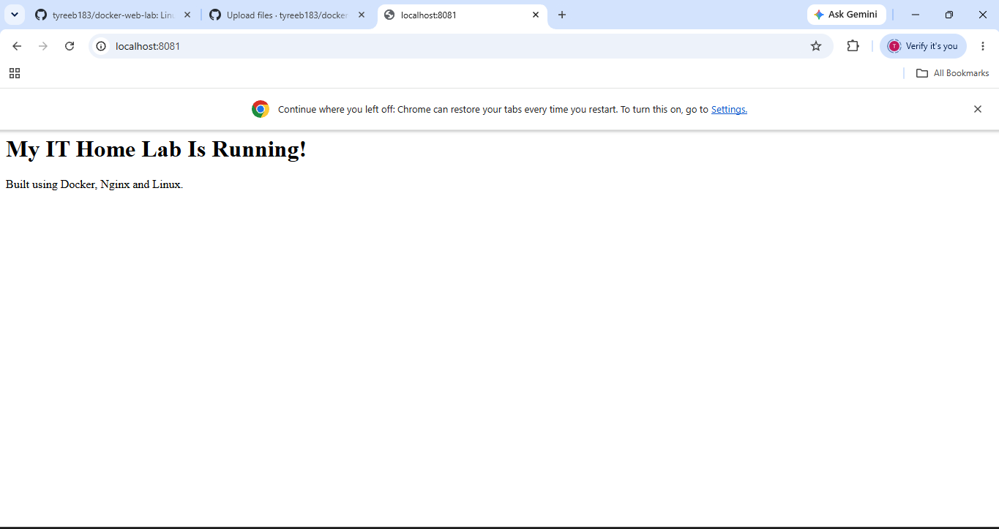
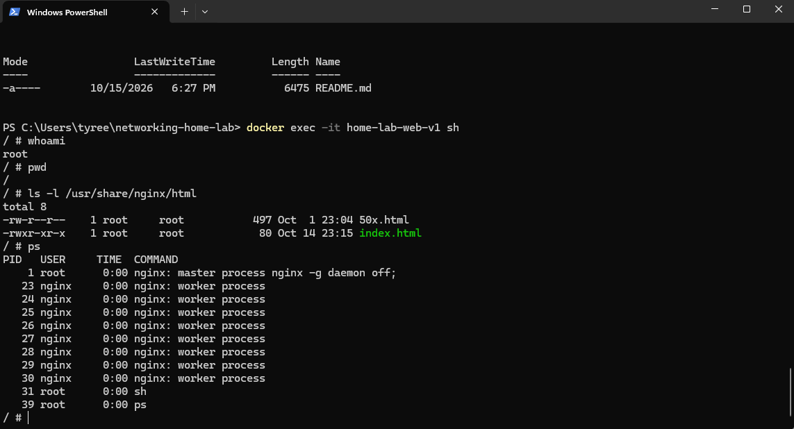
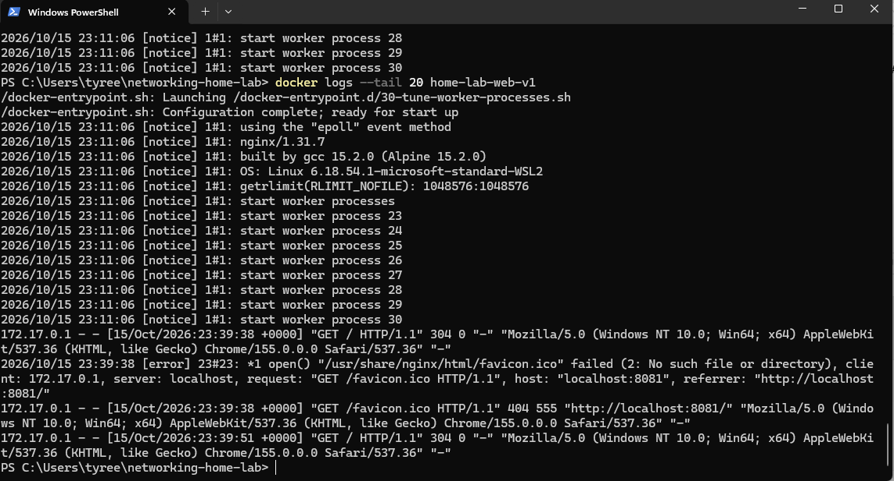
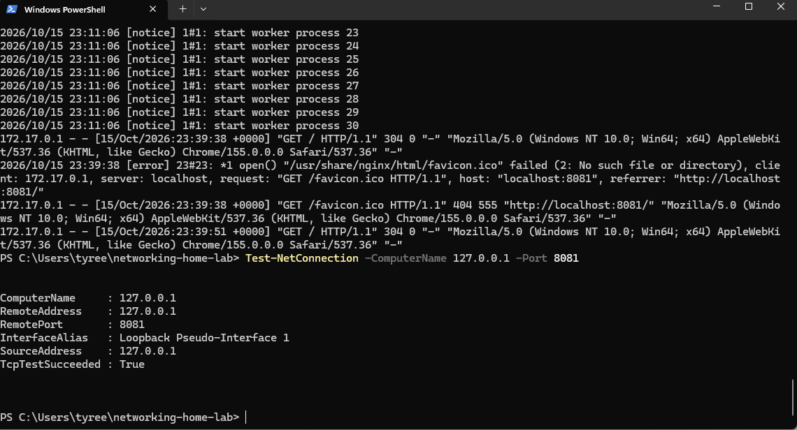

\# Linux Web Server Home Lab — Docker \& Nginx

\## Project Overview

This project demonstrates how to deploy, configure, administer, and troubleshoot an Nginx web server running inside a Linux Docker container on Windows 11.

The purpose of this home lab is to develop hands-on skills in Linux administration, containerization, networking, web server deployment, and troubleshooting.

\## Technologies Used

\- Windows 11

\- Windows Subsystem for Linux (WSL 2)

\- Ubuntu Linux

\- Docker Desktop

\- Alpine Linux

\- Nginx Web Server

\- Windows PowerShell

\- HTML

\- GitHub

\## Project Objectives

1\. Install and configure the Linux environment.

2\. Deploy a web server using Docker.

3\. Create and host a customized HTML webpage.

4\. Practice Linux administration commands.

5\. Inspect running server processes.

6\. Analyze web server logs and HTTP status codes.

7\. Test TCP/IP network connectivity.

8\. Build a reusable Docker image using a Dockerfile.

\## Implementation

\### 1. Docker Container Deployment

Deployed an Nginx web server using Docker.

Command: `docker run -d --name home-lab-web -p 127.0.0.1:8080:80 nginx:alpine`

Verified that the server was accessible at `http://localhost:8080`.

\### 2. Webpage Customization

Created an HTML file named `index.html` displaying:

\*\*My IT Home Lab Is Running!\*\*

Built using Docker, Nginx and Linux.

Copied the webpage into the Nginx container using the `docker cp` command.

\### 3. Linux Administration

Accessed the Linux container using:

`docker exec -it home-lab-web sh`

Executed Linux commands:

\- `whoami` — Identified the current user.

\- `pwd` — Displayed the current working directory.

\- `ls -l /usr/share/nginx/html` — Inspected website files and permissions.

\- `ps` — Examined running Nginx processes.

\### 4. Server Log Analysis

Used `docker logs --tail 20 home-lab-web` to examine Nginx activity.

Observed HTTP response codes:

\- \*\*200:\*\* Successful webpage request.

\- \*\*304:\*\* Browser cache validation.

\- \*\*404:\*\* Missing favicon file.

Confirmed that the web server was responding to requests.

\### 5. Networking Test

Tested connectivity using PowerShell:

`Test-NetConnection -ComputerName 127.0.0.1 -Port 8080`

\*\*Result:\*\* `TcpTestSucceeded : True`

This verified successful TCP connectivity to the locally published web server port.

\### 6. Custom Docker Image

Created a Dockerfile containing:

`FROM nginx:alpine`

`COPY index.html /usr/share/nginx/html/index.html`

Built the custom image using:

`docker build -t docker-web-lab:v1 .`

Launched the custom image using:

`docker run -d --name home-lab-web-v1 -p 127.0.0.1:8081:80 docker-web-lab:v1`

Successfully accessed the customized webpage at `http://localhost:8081`.

\## How to Run This Project

Prerequisites: Docker Desktop installed and running with Linux container support.

1\. Download or clone this repository.

2\. Open PowerShell in the project directory.

3\. Run `docker build -t docker-web-lab:v1 .`

4\. Run `docker run -d --name home-lab-web-v1 -p 127.0.0.1:8081:80 docker-web-lab:v1`

5\. Open `http://localhost:8081` in a browser.

If port 8081 or the container name is already in use, choose an unused port or container name.

\## Skills Demonstrated

\- Linux command-line administration

\- Docker image creation and container management

\- Nginx web server deployment

\- TCP/IP and port mapping

\- Web server log inspection

\- HTTP troubleshooting

\- Basic HTML configuration

\- Technical documentation

\## Project Results

Successfully deployed and tested a customized Nginx web server inside a Linux container.

Confirmed that the application responded to browser requests and passed local TCP connectivity testing.

\## Screenshots

Screenshots documenting deployment, command execution, server logs, networking tests, and the running webpage will be added to this repository.

\## Future Improvements

\- Configure custom Nginx settings.

\- Add container health checks.

\- Explore Linux file permissions and security.

\- Learn Docker Compose.

\- Add automated deployment testing.

## Web Server Screenshot

